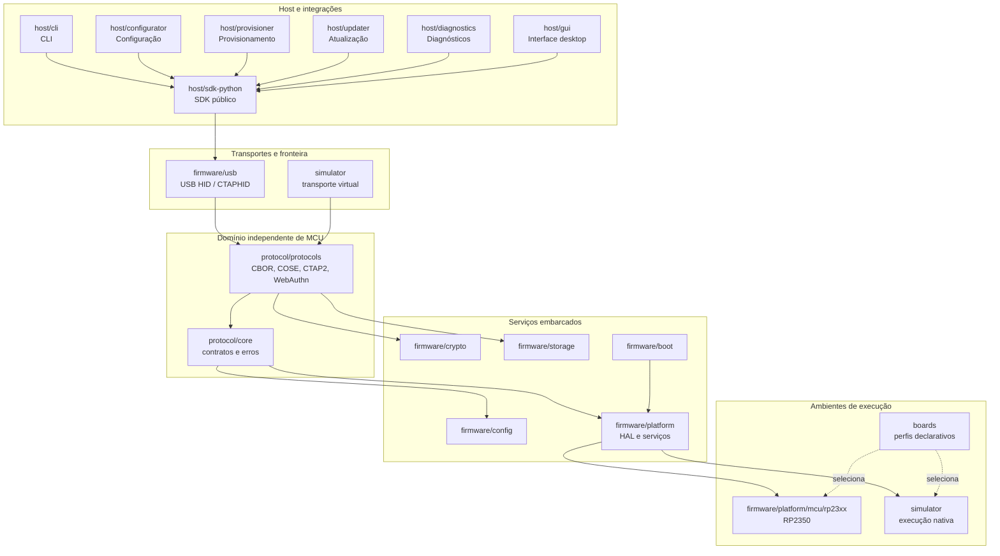

# Arquitetura do OpenKey Ecosystem

**Status:** proposta canônica para evolução incremental  
**Escopo:** firmware, protocolos, simulador, host, placas, testes e operações  
**Regra principal:** a arquitetura documenta o sistema existente; não cria uma segunda árvore de código.

## 1. Objetivo

O OpenKey Ecosystem é uma plataforma modular para construir, testar, distribuir e operar autenticadores FIDO2/WebAuthn. O núcleo de segurança deve ser reutilizável entre o simulador e diferentes microcontroladores, enquanto as ferramentas host usam os mesmos contratos de transporte e protocolo.

A arquitetura separa cinco preocupações:

1. **protocolo e domínio**, independentes de hardware;
2. **serviços embarcados**, que conectam o domínio à plataforma;
3. **targets**, que definem o ambiente de execução;
4. **integrações host**, que administram dispositivos e automação;
5. **verificação e operações**, que garantem interoperabilidade, atualização e rastreabilidade.

## 2. Mapa do sistema



As setas sólidas representam dependências de execução. As setas pontilhadas representam configuração de target; perfis de placa não devem conter lógica de protocolo.

## 3. Layout canônico do monorepo

```text
openkey/
├── protocol/
│   ├── core/                 # contratos do núcleo e erros de domínio
│   └── protocols/            # CBOR, COSE, CTAP2, CTAP-HID e WebAuthn
├── firmware/
│   ├── platform/             # abstrações de plataforma e serviços
│   │   └── mcu/rp23xx/       # target de referência RP2350
│   ├── crypto/               # integração de primitivas criptográficas
│   ├── storage/              # persistência e recuperação
│   ├── usb/                  # transporte USB/HID
│   ├── config/               # configuração e políticas
│   └── boot/                 # imagem, boot e atualização segura
├── simulator/                # target nativo para desenvolvimento e CI
├── boards/                   # perfis, templates e exemplos de placas
├── host/
│   ├── sdk-python/           # API de integração
│   ├── cli/                  # comandos para usuários e operadores
│   ├── configurator/         # configuração
│   ├── provisioner/          # provisionamento
│   ├── updater/              # atualização
│   ├── diagnostics/          # diagnóstico
│   └── gui/                  # interface desktop
├── tests/                    # unit, integration, interoperability, regression, hardware
├── fuzz/                     # entradas malformadas e fuzzing
├── tools/                    # scripts e geradores
├── docs/                     # documentação Diátaxis e ADRs
└── .github/workflows/        # validação e release
```

Esse layout é **incremental**: módulos existentes permanecem em seus diretórios atuais. Uma nova abstração só deve ser criada quando houver código, contrato ou teste que justifique sua existência.

## 4. Regras de dependência

### 4.1 Regras obrigatórias

- `protocol/core` não pode depender de `firmware`, `host` ou de um MCU específico.
- `protocol/protocols` pode depender de `protocol/core` e de interfaces criptográficas, mas não de registradores ou HAL de placa.
- `firmware/platform` implementa contratos de hardware; não redefine o comportamento dos protocolos.
- `firmware/platform/mcu/*` é código de target e pode depender das camadas embarcadas, mas não deve ser importado pelo núcleo de protocolo.
- `simulator` deve exercitar as mesmas interfaces usadas pelo firmware sempre que o comportamento puder ser reproduzido no host.
- `host/*` comunica-se por contratos públicos de transporte; não acessa diretamente armazenamento interno ou chaves privadas do dispositivo.
- `boards/` contém dados declarativos e metadados de build. Código executável pertence ao target correspondente.
- `tests/` e `fuzz/` podem depender dos componentes sob teste, mas não devem introduzir dependências de produção.

### 4.2 Direção das camadas

```text
host → transporte → protocolos → domínio
                              ↓
                 crypto / storage / config
                              ↓
                         platform → target
```

Dependências circulares entre essas camadas são proibidas. Quando duas camadas precisam compartilhar comportamento, deve-se extrair um contrato pequeno e testável, não importar a implementação inteira.

## 5. Contratos públicos

| Contrato | Consumidores | Responsabilidade |
|---|---|---|
| Protocolo CTAP2/WebAuthn | simulator, USB, host SDK | comandos, respostas, erros e codificação |
| Transporte CTAPHID | USB, simulator, host SDK | enquadramento, canais, timeouts e reassembly |
| Plataforma | RP23xx, simulator | RNG, relógio, presença do usuário, armazenamento e I/O |
| Armazenamento | firmware, simulator, testes | atomicidade, integridade, recuperação e wear-leveling |
| Atualização | boot, updater, provisioner | manifesto, assinatura, versão e rollback |
| Diagnóstico | diagnostics, CLI, GUI | estado operacional sem expor material secreto |

Mudanças nesses contratos exigem testes de compatibilidade, registro em ADR e atualização da documentação de referência.

## 6. Fluxos principais

### Registro e autenticação

1. Um cliente WebAuthn envia uma operação ao autenticador.
2. O host SDK encaminha o comando pelo transporte CTAPHID.
3. `protocol/protocols` decodifica, valida limites e despacha o comando.
4. O domínio consulta política, presença do usuário, credenciais e armazenamento.
5. `firmware/crypto` executa operações criptográficas usando chaves protegidas.
6. A resposta é codificada de forma canônica e devolvida pelo transporte.

### Desenvolvimento sem hardware

1. O desenvolvedor altera o núcleo ou um protocolo.
2. O `simulator` fornece as implementações de plataforma necessárias.
3. Testes unitários, integração, interoperabilidade e fuzzing exercitam o mesmo contrato.
4. O target RP2350 recebe validação adicional quando a mudança toca HAL, memória, boot ou USB.

### Atualização segura

1. `host/updater` obtém um pacote com manifesto assinado.
2. O dispositivo valida assinatura, versão e compatibilidade de target.
3. `firmware/boot` grava a imagem em área segura e mantém recuperação.
4. O boot confirma a imagem somente após a inicialização bem-sucedida.
5. Falhas retornam ao estado anterior; não há atualização parcialmente aceita.

## 7. Segurança e limites de confiança

- A fronteira host–dispositivo é não confiável; toda entrada deve ser validada no dispositivo.
- O transporte pode truncar, duplicar, reordenar ou atrasar pacotes; o parser não deve assumir uma sequência válida.
- Material secreto não deve aparecer em logs, diagnósticos, dumps do simulador ou APIs host.
- Operações criptográficas devem usar as abstrações aprovadas em `firmware/crypto`.
- O caminho de boot e atualização deve falhar fechado e preservar recuperação.
- O simulador é uma ferramenta de validação, não uma prova de equivalência física do hardware.

Detalhes normativos ficam em `SECURITY.md`, `docs/security/` e no modelo de ameaças do projeto.

## 8. Testes e qualidade

| Camada | Local | Gate mínimo |
|---|---|---|
| Rust workspace | crates Rust do workspace | `cargo fmt`, `cargo test --workspace` |
| Lint | workspace, excluindo target embarcado quando necessário | Clippy com `-D warnings` |
| Host | `host/*` | pytest em ambiente headless |
| Interoperabilidade | `tests/interoperability/` e ferramentas externas | cenários CTAP2/WebAuthn rastreáveis |
| Robustez | `fuzz/` | harnesses para CBOR, CTAP2 e CTAPHID |
| Hardware | `tests/hardware/` | execução em placa e evidência do target |

A CI deve separar gates por ambiente: host, simulador, firmware embarcado e ferramentas. Um erro de uma plataforma não deve mascarar qual contrato falhou.

## 9. Evolução sem desorganizar o projeto

1. **Manter o layout atual:** não mover módulos funcionais para diretórios genéricos como `legacy/` apenas para criar uma nova árvore.
2. **Adicionar contratos antes de implementações:** primeiro documentar API, invariantes e testes.
3. **Adicionar um target por vez:** cada MCU novo deve trazer perfil, HAL, build e testes mínimos.
4. **Promover somente código real:** diretórios vazios ou placeholders ficam fora do workspace até terem um propósito verificável.
5. **Usar ADRs para mudanças estruturais:** toda mudança de layout deve explicar migração, compatibilidade e rollback.
6. **Revisar o estado implementado:** documentação deve distinguir `implementado`, `experimental`, `planejado` e `não suportado`.

## 10. Estado atual e próximos incrementos

- **Implementado:** workspace Rust com protocolo, firmware, target RP23xx e simulador; host Python modular; boards, fuzz, testes e CI.
- **Em evolução:** contratos entre o simulador e serviços de plataforma; cobertura de interoperabilidade; ferramentas de atualização e provisionamento.
- **Planejado:** novos targets MCU, SDKs adicionais, GUI completa e certificação formal.

O OpenKey Ecosystem cresce pela consolidação desses contratos, não pela duplicação do workspace.
